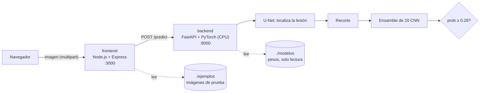

# OVARA · Demo local en Docker

Demo web de **OVARA**, una plataforma de IA que apoya al ginecólogo en la detección de **endometrioma** en ultrasonido. Subes una imagen y el sistema hace cuatro cosas:

1. **Localiza** la lesión con una red de segmentación (U-Net).
2. **Recorta** la lesión con un margen de tejido alrededor.
3. **Consulta** a un ensamble de 20 redes neuronales (ResNet18 ×15 y EfficientNet-B0 ×5) y promedia su probabilidad.
4. **Alerta** si la probabilidad supera **0.28**. Ese umbral se calibró con validación cruzada para no dejar pasar casos.

Además muestra **dónde miró el modelo** (Grad-CAM) y, si la imagen es de la prueba de MMOTU, el diagnóstico real para compararlo.

> ⚠️ **Demo académico** (Tecmilenio · Gestión de Proyectos de IA). No es un dispositivo médico ni sustituye el juicio clínico. El modelo se entrenó y evaluó solo con MMOTU, que viene de un solo centro, y todavía no tiene validación externa.

## Desempeño del modelo empaquetado

Medido en la prueba de MMOTU (469 estudios nunca vistos en el entrenamiento), con el flujo automático completo:

| Modelo | Recall (detecta) | Precisión (alertas correctas) | AUC |
|---|---|---|---|
| Random Forest sobre medidas (Actividad 6) | 0.80 | 0.51 | 0.86 |
| **OVARA: U-Net + ensamble de CNN (este demo)** | **0.87** | **0.81** | **0.93** |

## Arquitectura



| Servicio | Imagen | Tecnología | Puerto | Qué hace |
|---|---|---|---|---|
| `frontend` | `ovara-frontend:1.0.0` | Node.js 22, Express 4, Multer 2 | 3000 | Sirve la interfaz, valida la carga, reenvía la imagen al backend y lista los ejemplos |
| `backend` | `ovara-backend:1.0.0` | Python 3.12, FastAPI, PyTorch 2.8 (CPU) | 8000 | Carga el modelo y hace la inferencia. También da la documentación de la API en `/docs` |

- Las dos imágenes corren con un usuario sin privilegios y tienen `HEALTHCHECK`.
- Los pesos **no van dentro de la imagen**: se montan como volumen de solo lectura. Así la imagen queda ligera y el modelo se puede actualizar sin reconstruirla.

## Requisitos

- [Docker Desktop](https://www.docker.com/products/docker-desktop/) (Windows o macOS) o Docker Engine con Compose v2 (Linux). Asígnale al menos 4 GB de RAM.
- Git.
- Python 3.9 o superior, solo para los scripts de apoyo. Usan únicamente la biblioteca estándar, excepto `exportar_modelo.py`.
- No se necesita GPU: la inferencia corre en CPU (1–2 s por imagen).

## Inicio rápido

> ¿Primera vez y sin nada instalado? Sigue la guía paso a paso **[EJECUCION.md](EJECUCION.md)**.

### Opción rápida: todo en un solo paso

Después de clonar el repositorio, entra a la carpeta `OVARA` y ejecuta:

```powershell
iniciar_demo.bat               # Windows (doble clic también funciona)
./iniciar_demo.sh              # Linux / macOS
```

El script hace lo siguiente:

1. Verifica Docker y Python.
2. Enciende Docker Desktop si está apagado.
3. Descarga y verifica los pesos del modelo, solo la primera vez.
4. Construye y enciende los contenedores.
5. Espera a que el modelo cargue.
6. Abre el navegador en http://localhost:3000.

Para correr además todas las pruebas, usa `iniciar_demo.bat evidencias`. Para detener el demo, usa `detener_demo.bat`.

Los pasos manuales equivalentes están a continuación.

### 1. Clonar el repositorio

```bash
git clone https://github.com/emiliocalderonv/TecMilenio_GPAI.git
cd TecMilenio_GPAI/OVARA
```

### 2. Obtener los pesos del modelo (~400 MB)

**Opción A. Descargarlos del Release de GitHub.** Es lo normal para quien clona el repo:

```bash
python scripts/descargar_modelos.py --url https://github.com/emiliocalderonv/TecMilenio_GPAI/releases/download/ovara-v1.0.0/ovara_modelos_v1.0.0.zip
```

**Opción B. Exportarlos desde el experimento original.** Solo funciona en el equipo donde se entrenó y requiere PyTorch:

```powershell
python scripts/exportar_modelo.py --origen C:\Proyectos\AI\OVARA\Experimento_CNN
```

**Opción C. Sin pesos (modo prueba).** El backend usa pesos aleatorios. Sirve solo para probar que todo se integra:

```bash
# Windows PowerShell
$env:OVARA_MODO_PRUEBA="1"; docker compose up --build
# Linux / macOS
OVARA_MODO_PRUEBA=1 docker compose up --build
```

### 3. Agregar imágenes de prueba (opcional)

Copia imágenes de la prueba de MMOTU con su etiqueta real:

```powershell
python scripts/copiar_ejemplos.py --mmotu C:\Proyectos\AI\OVARA\datos_ini\MMOTU\OTU_2d
```

Por defecto copia 16 imágenes (8 endometriomas y 8 de otras lesiones). Usa `--todas` para copiar las 469.

### 4. Construir y ejecutar

```bash
docker compose up --build -d
```

- La primera construcción tarda de 5 a 10 minutos, porque descarga PyTorch CPU.
- Abre **http://localhost:3000**.
- La documentación de la API está en **http://localhost:8000/docs**.
- Para detener la demo: `docker compose down`.

## Uso

1. Arrastra un ultrasonido (JPG o PNG) o elige una imagen de la galería de ejemplos.
2. Haz clic en **Analizar imagen**.
3. Revisa el resultado:
   - El veredicto: alerta o sin alerta.
   - La probabilidad frente al umbral.
   - Cuántas de las 20 redes votaron por la alerta.
   - El contorno de la lesión, el recorte analizado y el mapa de atención.
   - En las imágenes de ejemplo, si el resultado coincide con el diagnóstico real.

## API

| Método | Ruta | Servicio | Descripción |
|---|---|---|---|
| GET | `/` | frontend | Interfaz web |
| GET | `/api/salud` | frontend | Estado del frontend y del backend |
| GET | `/api/info` | frontend → backend | Versión del modelo, umbral, número de redes y métricas de validación |
| GET | `/api/ejemplos` | frontend | Imágenes de `./ejemplos` con su etiqueta |
| POST | `/api/analizar?gradcam=true` | frontend → backend | Campo `imagen` (multipart). Devuelve probabilidad, alerta, acuerdo entre redes, lesión, tiempos e imágenes en base64 |
| GET | `/health`, `/info` | backend | Salud e información del modelo |
| POST | `/predict` | backend | Inferencia directa |

Ejemplo de llamada:

```bash
curl -F "imagen=@ejemplos/<imagen>.JPG" "http://localhost:3000/api/analizar?gradcam=false"
```

## Evidencias de integración

```bash
python scripts/evidencias.py                      # construye, prueba, despliega y genera el reporte
python scripts/evidencias.py --paridad-mmotu C:\Proyectos\AI\OVARA\datos_ini\MMOTU\OTU_2d   # + paridad
```

El reporte queda en `evidencias/<fecha>/REPORTE.md`, con una copia en `evidencias/ULTIMO_REPORTE.md`. Cubre lo siguiente:

1. **Entorno:** versiones de Docker y Compose, sistema operativo y commit.
2. **Construcción:** registro del `docker compose build` y tamaño de las imágenes.
3. **Pruebas unitarias dentro de los contenedores:**
   - `pytest` en el backend: contrato de la API, errores y utilidades.
   - `node --test` en el frontend: proxy, ejemplos y validaciones.
4. **Despliegue:** `docker compose up`, tiempo hasta que el modelo queda cargado y `docker compose ps`.
5. **Integración de punta a punta:** cada ejemplo pasa por navegador → Node.js → FastAPI → modelo. Se guarda la respuesta JSON y las imágenes generadas.
6. **Pruebas negativas:** un archivo que no es imagen (415), una imagen dañada (422) y un archivo de más de 10 MB (413).
7. **Paridad (opcional):** el contenedor reproduce las 469 predicciones del modelo validado. Compara alertas idénticas, diferencia de probabilidad y métricas.
8. **Bitácoras:** registros de ambos contenedores.

Además, **GitHub Actions** (`.github/workflows/ovara-ci.yml`, en la raíz del repo) corre en cada `push` que toque `OVARA/`: las pruebas del backend y del frontend, la construcción de ambas imágenes y la prueba de punta a punta en modo prueba. Las evidencias quedan como artefacto de la ejecución.

## Publicar los pesos como Release de GitHub

`exportar_modelo.py` genera `ovara_modelos_v1.0.0.zip` en la raíz del repo. Ese zip está en `.gitignore` y no se sube con `git push`. Súbelo así:

- **Web:** en GitHub, ve a *Releases* → *Draft a new release* → tag `ovara-v1.0.0` → adjunta el zip → *Publish*.
- **CLI:**

  ```bash
  gh release create ovara-v1.0.0 ovara_modelos_v1.0.0.zip --title "OVARA modelo v1.0.0" --notes "U-Net + ensamble de 20 CNN, umbral 0.28"
  ```

## Estructura

```
TecMilenio_GPAI/
├── .github/workflows/ovara-ci.yml   # CI (GitHub solo lee workflows en la raíz)
└── OVARA/
    ├── docker-compose.yml        # orquesta backend + frontend
    ├── .env.example              # puertos, modo prueba, hilos
    ├── backend/                  # FastAPI + PyTorch CPU
    │   ├── Dockerfile
    │   ├── requirements.txt
    │   ├── app/                  # main.py (API), inferencia.py (flujo), arquitecturas.py (redes)
    │   ├── tests/test_api.py
    │   └── paridad.py            # comparación con el modelo validado
    ├── frontend/                 # Node.js + Express
    │   ├── Dockerfile
    │   ├── package.json, package-lock.json
    │   ├── server.js
    │   ├── public/               # index.html, app.js, styles.css
    │   └── test/server.test.js
    ├── scripts/                  # exportar / descargar pesos, copiar ejemplos, evidencias
    ├── modelos/                  # pesos (no versionados; se montan en el backend)
    ├── ejemplos/                 # 16 imágenes de prueba MMOTU + etiquetas.csv
    ├── evidencias/               # reportes de integración
    ├── iniciar_demo.bat / .sh   # todo en un solo paso
    ├── detener_demo.bat
    └── publicar_en_repo.bat     # copia este proyecto a <repo>/OVARA y coloca el workflow
```

## Solución de problemas

| Síntoma | Causa y solución |
|---|---|
| La interfaz dice **"Sin modelo"** | Falta `modelos/modelo_ovara.json`. Haz el paso 2 o usa el modo prueba |
| **"Esperando backend…"** por más de un minuto | El backend sigue cargando las 21 redes, o se quedó sin memoria. Revisa `docker compose logs backend` y sube la RAM de Docker Desktop |
| El puerto 3000 u 8000 está ocupado | Copia `.env.example` a `.env` y cambia `PUERTO` o `PUERTO_API` |
| La construcción falla al descargar PyTorch | Hubo un problema de red. Vuelve a ejecutar `docker compose build` |
| El análisis es lento | Es normal en CPU (1–2 s). Desactiva *Grad-CAM* para acelerarlo |

## Créditos y datos

- **Datos:** MMOTU. Zhao, Q., Lyu, S., Bai, W., *et al.* (2022). *A Multi-Modality Ovarian Tumor Ultrasound Image Dataset for Unsupervised Cross-Domain Semantic Segmentation*. arXiv:2207.06799. Es de uso académico.
- **Modelo:** OVARA Fase 2, entrenado por Emilio Calderón, Tecmilenio, 2026.
